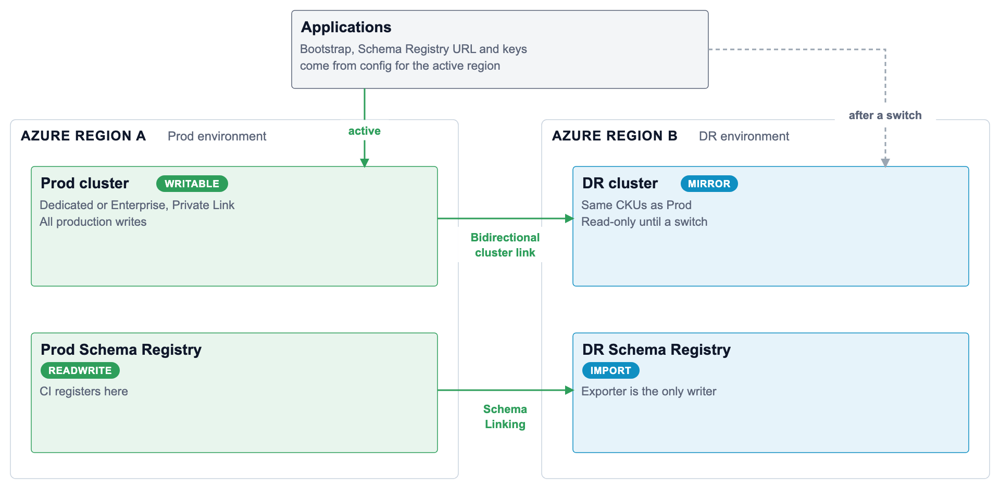
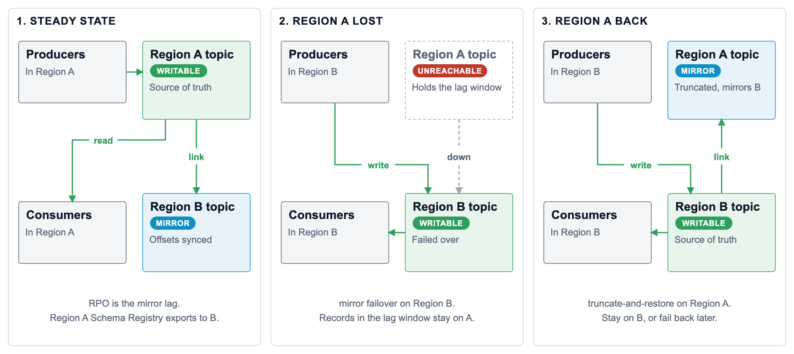

# Confluent Cloud regional DR runbook: Cluster Linking and Schema Linking between two Azure regions

Sriram Kannan, GoodLabs Studio · Version 0.1 · November 2026 · Draft for review with the platform team · Companion: CP to Confluent Cloud migration runbook

## 1. Purpose and summary

Confluent Cloud Prod runs in Azure Region A and goes live at the end of November 2026. The DR cluster runs in Region B. This runbook sets up DR between the two and gives the procedures for moving production between them: a planned switchover, an unplanned failover when Region A is lost, and the return to two-region protection afterwards. Schema Registry is part of every procedure, because a consumer in Region B can't read a message whose schema ID doesn't exist there.

The design is Confluent's documented active-passive pattern with manual switchover. Producers write in one region at a time. A cluster link copies topic data and consumer offsets to Region B, and Schema Linking copies schemas with the same IDs. Confluent's managed Automatic Failover would give clients a single global bootstrap endpoint, but it is Limited Availability today, so it isn't part of go-live. We revisit it when it reaches general availability. We rejected active-active: it needs every app to handle two clusters at once, which means code changes in every app before go-live, for an RTO gain the business hasn't asked for.

In short:

- Prod and DR sit in separate Confluent Cloud environments in the same organization. Schema Registry is one per environment and lives in one region, so a second environment is the only way to get a second registry in Region B.
- One bidirectional cluster link joins the two clusters from day one. That is Confluent's stated best practice for DR, and it is what makes the reverse and truncate-and-restore commands available for switchover and failback.
- Every production topic is mirrored to Region B with its consumer offsets. Prod Schema Registry exports every subject to DR Schema Registry, which stays in `IMPORT` mode until a switch.
- Identities, role bindings, API keys, cluster settings and network paths exist in both regions before anything goes wrong. None of them are copied by the link.
- A planned switchover uses `reverse-and-start` and loses no data. An unplanned failover uses `mirror failover`, and records still in the mirror lag at that moment stay behind in Region A.
- After an unplanned failover the default is to stay in Region B and rebuild Region A as the new DR side. Failing back is a separate planned change.

RPO is the mirror lag at the moment of failover. Confluent Cloud has no zero-RPO option, because that needs synchronous replication. RTO is however long it takes to decide, run the failover commands and restart clients against Region B, so it depends on the client tooling in section 5 and is measured in the DR tests in section 7.

| Topic | Type | Covered in |
|---|---|---|
| **What must exist before DR counts as ready** | Prerequisites | Section 2 |
| **Rules, link configuration, RPO and RTO** | Design | Section 3 |
| **Schema Registry in both regions** | Design | Section 4 |
| **Clients, connectors, Flink and Streams apps** | Design | Section 5 |
| **Add topics, steady-state checks, switchover, failover, restore, failback** | Runbook | Section 6 |
| **DR testing** | Assurance | Section 7 |
| **What goes wrong and what to do** | Failure modes | Section 8 |
| **Points to plan for, open questions and next steps** | Actions | Sections 9 to 11 |

## 2. Starting point and entry criteria

### 2.1 What is in place

| Component | Current state |
|---|---|
| **Prod cluster, Region A** | Built by hand: an Azure pipeline creates keys and networking, then the cluster is created in the Cloud Console. The DR cluster is built from the same written runbook so the two match. |
| **Topic and RBAC provisioning** | Automated pipeline. It must apply every topic setting, role binding and Schema Registry role binding to both regions (rules 5 and 6 in section 3.1). |
| **Migration waves** | On-prem apps arrive on Prod in waves. The migration runbook hands each topic to this runbook on the day it starts taking writes on Prod (section 6.1). |
| **Client configuration** | Apps read bootstrap, Schema Registry URL and credentials from config. Whether every app can be repointed by config alone isn't confirmed yet (section 5.1). |

### 2.2 Entry criteria

DR counts as ready for go-live only when every row below holds. Rows that depend on Region A also apply again after a fail-forward, with the regions swapped.

| Requirement | Why it matters |
|---|---|
| **Both clusters in the same Confluent Cloud organization** | A bidirectional link with one service account, and private-to-private linking, both need it. |
| **Prod and DR in separate environments** | Each environment has one Schema Registry in one region. A shared environment would leave Region B with no registry of its own. |
| **Both clusters Dedicated or Enterprise, with the same CKU count** | Cluster Linking DR needs Dedicated or Enterprise. Region B has to carry full production load after a switch. |
| **Both regions on Confluent's list of Azure regions that support Cluster Linking over private networking** | Private-to-private links on Azure are available only in a subset of regions, including eastus, eastus2, centralus and westus2. |
| **Private Link endpoints and private DNS for both clusters, from every app network** | Apps connect to Region B from where they run. A network path built during an outage won't be ready in time. |
| **An admin host that can reach both clusters** | Cluster Linking commands must run from a network location that can reach the cluster they act on. In a Region A outage, that host must not be in Region A. |
| **Credentials on Region B for every app** | Cluster-scoped API keys and RBAC role bindings aren't copied by the link. Service accounts are organization-scoped, so they already exist. |
| **Cluster and topic settings on Region B that the link doesn't copy** | Cluster settings aren't kept aligned, and topic-level schema validation (`confluent.key.schema.validation`, `confluent.value.schema.validation`) is never synced. |
| **Monitoring and alerting on Region B** | Dashboards and alerts that only watch Region A go dark at the moment they're needed. |

> **Recommendation for the platform team:** pick the Region A and Region B pair from Confluent's list of Azure regions that support Cluster Linking over private networking, and check the pair with risk for data residency before building Region B. To test: in UAT, create a bidirectional link between clusters in the chosen regions over Private Link and mirror one topic to zero lag.

## 3. Target design

Region A holds the writable topics and the `READWRITE` Schema Registry. Region B holds read-only mirror topics and a Schema Registry in `IMPORT` mode. Applications run against Region A and hold a second set of connection settings for Region B that they switch to only when told. This cluster link is a different link from the ones in the migration runbook: those run one way from each on-prem CP cluster to Prod and are deleted after the last wave.



*Figure 1. Steady state. Region A takes every write. The bidirectional link mirrors topics and offsets to Region B, and Schema Linking copies every schema with the same ID.*

### 3.1 Rules

1. **Active-passive only.** Producers write to one region at a time. Consumers that run in Region B during normal operation use their own consumer group names, never the name of a group that runs in Region A.
2. **One bidirectional link, named `prod-dr`, from day one.** It is created on both clusters with the same name. It carries no topic prefix, because the reverse commands don't work on prefixed links.
3. **Every production topic is mirrored, and mirror topics are created on purpose.** `auto.create.mirror.topics.enable=false`. A topic is added through the procedure in section 6.1 on the day it starts taking writes in Region A.
4. **Consumer offsets sync for every group.** Consumers restart in Region B close to where they stopped instead of at the start or end of the topic.
5. **Role bindings come from the RBAC automation, applied to both regions.** RBAC role bindings aren't synced by the link, and the link's `acl.sync.enable` stays `false` because access is managed with RBAC, not ACLs.
6. **Settings the link doesn't copy are applied to both clusters by automation.** Cluster settings and topic-level schema validation drift otherwise, and the drift shows only after a switch.
7. **Schema Linking exports every subject from the active region to the passive one.** The passive registry stays in `IMPORT` mode, so the exporter is its only writer. CI registers schemas only in the active region.
8. **Apps switch region by configuration, not by code change.** Bootstrap server, Schema Registry URL and credentials for both regions are held in the vault or config service, keyed by the active region.
9. **Planned moves use `reverse-and-start`. `mirror failover` is for when Region A can't be reached.** Reverse waits until both sides are identical before it makes Region B writable. Failover doesn't wait, and its lag window is lost.
10. **Failover is declared by the incident lead, never by automation.** The decision trades a known data loss (the lag window) against continued outage, which is a business call.
11. **After an unplanned failover, stay in Region B.** Failing back is another production switch with its own risk. We do it only when Region A is worth the move, for latency or cost, as a planned change after Region A is healthy and mirroring again.
12. **Never delete the link or a mirror topic during a switch or while any topic is in a `PENDING_` state.** Deleting the link also deletes the record of the offsets at which each topic failed over, which is what section 6.5 needs to recover lagged data.

### 3.2 Link configuration

Each side of a bidirectional link has its own settings, and they apply only to data and metadata arriving on that side. Offset sync must therefore be switched on in both halves, so that offsets still flow to whichever region is passive after a switch.

```properties
# prod-dr.properties  (used for both halves of the link)
link.mode=BIDIRECTIONAL
# Nothing mirrors until section 6.1 creates it.
auto.create.mirror.topics.enable=false
# Access is RBAC, applied to both regions by automation.
acl.sync.enable=false
# Offsets for every consumer group.
consumer.offset.sync.enable=true
consumer.offset.sync.ms=30000
consumer.offset.group.filters={"groupFilters":[{"name":"*","patternType":"LITERAL","filterType":"INCLUDE"}]}
```

```bash
# Half on the DR cluster (Region B): it reads from Prod.
confluent kafka link create prod-dr --cluster lkc-dr01 \
  --remote-cluster lkc-prod01 --remote-bootstrap-server <prod-private-bootstrap> \
  --remote-api-key <link-key-on-prod> --remote-api-secret <secret> \
  --config prod-dr.properties

# Half on the Prod cluster (Region A): used after a switch.
confluent kafka link create prod-dr --cluster lkc-prod01 \
  --remote-cluster lkc-dr01 --remote-bootstrap-server <dr-private-bootstrap> \
  --remote-api-key <link-key-on-dr> --remote-api-secret <secret> \
  --config prod-dr.properties
```

The link has its own service account with an API key on each cluster, held in the vault and rotated on the 90-day cycle. On each cluster it needs the permissions Confluent lists for a cluster link on a source cluster, plus `Describe` and `DescribeConfigs` on the cluster for offset sync. The same service account serves both halves, because both clusters are in one organization.

> **Recommendation for the platform and app teams:** start with offset sync at 30 seconds. Confluent's DR tutorial uses 1 second, which cuts re-reads after a failover and costs link throughput. The interval decides how much a consumer re-reads, not how much data is lost. App teams whose re-reads are expensive ask for a shorter interval. To test: in each DR test, count the records each consumer group processes twice after the switch and compare against what the app can absorb.

### 3.3 RPO and RTO

| Measure | What sets it | How we track it |
|---|---|---|
| **RPO** | Mirror lag between Region A and Region B when Region A is lost. Records in that lag stay on Region A. | Max lag per topic from the Metrics API, alerting when lag passes the RPO the business sets. |
| **Consumer re-reads** | Offset sync interval plus mirror lag. Consumers restart from the last synced offset and process some records again. | Consumers must be idempotent. Measured in each DR test. |
| **RTO** | Time to detect and declare, run failover on every mirror topic, switch Schema Registry, and restart clients against Region B. | Measured end to end in each DR test, per app. |
| **Schema RPO** | Lag of the schema exporter. A schema registered on Region A that hasn't reached Region B makes its messages unreadable there. | Exporter status alerting (section 4.4). |

> **Recommendation for app teams:** state an RPO and RTO for each app by tier, and plan a replay from the app's own source if it can't accept any loss. No setting here gives zero RPO. To test: in each DR test, compare the measured RTO and the mirror lag at the switch against the app's targets.

## 4. Schema Registry

Cluster Linking copies messages byte for byte, including the schema ID each one carries. A consumer in Region B can only deserialize a message if Region B's registry has a schema with that ID. Schema Linking makes sure it does, and keeps the IDs identical.

### 4.1 Why two environments

Confluent Cloud provisions one Schema Registry per environment, in one region. Confluent's guidance is to place each registry in the same region as the cluster it serves. If Prod and DR shared an environment, a Region A outage would take the only registry with it. So Prod and DR are separate environments, each with its own registry, and Schema Linking joins them. The trade-off is that service accounts, role bindings and API keys are managed in two environments, which the RBAC automation already has to do for the clusters.

### 4.2 Steady state

1. Set DR Schema Registry to `IMPORT` mode before anything registers there. The registry is empty at that point, so the mode change applies cleanly.
2. Create an exporter on Prod Schema Registry that writes every subject to DR Schema Registry's default context. The default context is required for broker-side schema ID validation and the Console topic viewer on mirror topics.
3. Check that subject count, versions and IDs match between the two registries.

```properties
# prod-to-dr-exporter.properties  (destination: DR Schema Registry)
schema.registry.url=https://<dr-sr-private-endpoint>
basic.auth.credentials.source=USER_INFO
basic.auth.user.info=<dr-sr-api-key>:<dr-sr-api-secret>
```

```bash
# DR registry in IMPORT mode first (DR environment)
curl -u <dr-sr-admin-key>:<secret> -X PUT -H "Content-Type: application/json" \
  --data '{"mode":"IMPORT"}' https://<dr-sr-private-endpoint>/mode

# Exporter on Prod Schema Registry (Prod environment)
confluent schema-registry exporter create prod-to-dr \
  --subjects "*" --context-type NONE \
  --config prod-to-dr-exporter.properties --environment env-prod

confluent schema-registry exporter status describe prod-to-dr --environment env-prod
```

With `--subjects "*"` the exporter takes every subject in Prod's default context, including subjects created after it starts, so new topics need no exporter change. The exporter count is limited per environment (10 with the Essentials package, 100 with Advanced), and one exporter is enough here.

> **Recommendation for the platform team:** treat subjects that arrive through a linked migration wave as unprotected in DR until their schema close-out. The CP exporter writes them into Prod Schema Registry while they are in `IMPORT` mode, and it isn't yet known whether Prod passes an `IMPORT` subject on to DR (section 10). To test: in UAT, export a subject into a registry held in `IMPORT` mode that itself exports to a third registry, and check whether the subject arrives.

### 4.3 Switching the registries

Confluent's procedure turns the schema link around whenever production moves, in either direction. The order matters: the registry that is about to take writes must have every schema the other one has before it becomes `READWRITE`.

| Event | Region B registry | Region A registry | Exporter |
|---|---|---|---|
| **Steady state** | `IMPORT` | `READWRITE` | `prod-to-dr`, A to B |
| **Planned switchover (6.3)** | `READWRITE` after parity | `IMPORT` | Pause A to B, create `dr-to-prod`, B to A |
| **Unplanned failover (6.4)** | `READWRITE` at once | Unreachable | A to B is dead with Region A |
| **Region A back (6.5)** | `READWRITE` | `IMPORT`, then catches up | Pause A to B, create `dr-to-prod`, B to A |
| **Failback (6.6)** | `IMPORT` | `READWRITE` | Stop B to A, resume `prod-to-dr` |

### 4.4 Security and monitoring

- Each exporter authenticates to the other registry with a service-account API key held in the vault and rotated on the 90-day cycle. That service account has write access only to the destination registry.
- CI's registration credentials work only against the active region's registry. A CI job that writes to an `IMPORT` registry fails, which is the intended guard.
- Alert when the exporter isn't `RUNNING`, and run a daily parity check of subject count and latest IDs between the two registries.
- Audit changes to exporters and to registry mode. An exporter keeps running after its creator's access is revoked.

## 5. Clients and other components

### 5.1 Applications

The link moves data, offsets and schemas. It doesn't move clients. With manual switchover, each app needs a way to pick up Region B's bootstrap server, Schema Registry URL and credentials, and restart. That mechanism is what sets RTO.

| Item | Requirement |
|---|---|
| **Connection settings** | Both regions' settings held in the vault or config service, keyed by an active-region value that the incident lead changes once. Apps that hard-code a bootstrap server can't fail over in a known time. |
| **Credentials** | Region B API keys created ahead of time for every service account. OAuth through an identity pool removes per-cluster keys, and role bindings still exist per cluster. |
| **Consumer behaviour** | Consumers are idempotent, because they re-read from the last synced offset after a failover. Consumers that run in Region B in normal operation use group names that never run in Region A. |
| **Producers** | Producers in Region A lose write access during a planned switchover, so nothing writes to a topic that is about to become a mirror. Transactional producers switch one topic at a time (section 6.3). |
| **DNS** | A custom DNS name in front of each cluster is an option to cut config changes, and its TTL then becomes part of RTO. |

> **Recommendation for app teams:** read bootstrap server, Schema Registry URL and credentials from the config service, keyed by the active region, and restart cleanly when it changes. Apps without that switch go to the ARB as DR gaps. To test: in UAT, flip the active-region value and time how long it takes until the app produces or consumes successfully in Region B.

### 5.2 Connectors, Flink and stream processing

| Component | In Region B | Status |
|---|---|---|
| **Fully managed connectors** | Created in Region B from the same config in source control, paused or not created until a switch. Sink connectors start from offsets set through the connector offsets API, using the synced position of their Region A consumer group. | UAT test pending |
| **Flink SQL statements** | Compute pools and statements are regional. Region B has its own compute pool, and the statements are redeployed from source control with explicit starting offsets. Flink state doesn't move. | UAT test pending |
| **Kafka Streams apps** | Mirror the input topics only, not the internal changelog and repartition topics, which can be inconsistent with each other under async replication. The app rebuilds its state from the inputs in Region B, so compacted or tiered input topics are needed where state is large. | Confluent guidance |
| **ksqlDB** | Out of scope. ksqlDB workloads are rewritten as Flink SQL in the migration. | Not applicable |
| **Audit logs** | The audit log cluster is organization-wide and doesn't fail over with Prod. Check its region and how it is consumed. | Open, platform team |

> **Recommendation for the platform team:** keep connector and Flink definitions in source control with a Region B variant, so starting them in Region B is a deploy, not a rebuild. To test: in UAT, create a sink connector in Region B with offsets taken from its Region A group, and redeploy one Flink statement with explicit starting offsets. Check that the connector's target has no gap and the statement's output matches Region A.

## 6. Procedures

### 6.1 Add topics to DR

The migration runbook calls this procedure in its phase 5, and greenfield topics use it the day they go live.

1. Apply the topic's settings that the link won't copy to Region B, including schema validation.
2. Apply the topic's role bindings to Region B through the RBAC automation.
3. Create the mirror: `confluent kafka mirror create payments.transaction.completed --link prod-dr --cluster lkc-dr01`.
4. Check the topic's subjects exist in DR Schema Registry with the same IDs as Prod.
5. Check mirror lag reaches zero, then add the topic to the DR dashboards and the lag alert.

Done when the mirror is `ACTIVE` with zero lag and the topic appears on the DR dashboards.

### 6.2 Steady-state checks

| Check | Frequency | Alert when |
|---|---|---|
| **Link status, both halves** | Continuous | Either half isn't `ACTIVE`. |
| **Mirror lag per topic** | Continuous | Lag passes the RPO threshold for the topic's tier. |
| **Topics on Prod with no mirror** | Daily | Any production topic isn't mirrored after its first day of writes. |
| **Exporter status and registry parity** | Continuous and daily | Exporter isn't `RUNNING`, or subject counts or latest IDs differ. |
| **Region B credentials** | Weekly | A synthetic client can't authenticate to Region B with an app's credentials. |
| **Setting drift** | Daily | Cluster settings, schema validation or role bindings differ between regions. |

### 6.3 Planned switchover

Use this for DR tests and for planned regional maintenance. Both clusters must be healthy and reachable. No data is lost. The procedure moves every topic at once, because `reverse-and-start` needs every consumer group off Region A first.

**Before the window**

1. Raise the change, freeze schema registration in CI, and confirm app owners and the rollback owner for the window.
2. Confirm steady-state checks are green and every mirror topic's lag is near zero.

**In the window**

1. Stop every producer in Region A and remove their write role bindings there.
2. Wait out in-flight writes: at least the producers' `delivery.timeout.ms`, then two reads of the log-end offsets, 5 minutes apart, that match. This is the same rule as the migration runbook.
3. Stop every consumer in Region A. Wait two offset sync intervals, then confirm their offsets on Region B match Region A.
4. Switch the registries: pause `prod-to-dr`, confirm subject and ID parity, set Region B to `READWRITE` and Region A to `IMPORT`, then create the reverse exporter `dr-to-prod` with the same settings pointed at Region A.
5. On Region B, run `confluent kafka mirror reverse-and-start <topic> --link prod-dr --cluster lkc-dr01` for every mirror topic. Run transactional topics one at a time and wait for each to finish.
6. Run `confluent kafka mirror describe` on both clusters until every Region B topic is writable (`STOPPED`) and every Region A topic is an `ACTIVE` mirror. Don't start any app while a topic is in a `PENDING_` state.
7. Change the active-region value to Region B. Start consumers, then producers, against Region B.
8. App owners confirm end to end: produce and consume rates normal, lag falling, no auth or schema errors.

Done when every app has run in Region B for 30 minutes with no errors and Region A shows every topic mirroring from Region B with zero lag.

**Rollback**

Before the reverse step, restart producers and consumers in Region A, restore Region A's write access and switch the registries back. After it, the way back is the same procedure in the other direction, which is section 6.6.

### 6.4 Unplanned failover: Region A lost



*Figure 2. Unplanned failover and restore, one topic. Region B fails over and takes writes. When Region A returns, truncate-and-restore makes it a mirror of Region B.*

Use this only when Region A can't be reached and the incident lead declares a regional failover. If the link and both clusters still work, use section 6.3 instead, even under pressure, because it loses no data.

1. Incident lead declares the failover and records the time. Note the last known mirror lag per topic from the Metrics API, which is the data at risk.
2. From an admin host outside Region A, preview with `confluent kafka mirror failover <topic> --link prod-dr --cluster lkc-dr01 --dry-run`, then run it without `--dry-run` for every mirror topic. Failover succeeds whatever the lag and whether or not Region A answers.
3. Set DR Schema Registry to `READWRITE`. The `prod-to-dr` exporter can't run while Region A is down.
4. Change the active-region value to Region B. Start consumers, then producers. Start the Region B connectors and Flink statements (section 5.2).
5. App owners confirm end to end, and record which apps re-read data and how much.
6. Tell the business owners the failover time and the per-topic lag at failover, so they can plan reconciliation for the records left in Region A.

Done when every app runs in Region B with no errors and the business has the data-at-risk figures.

### 6.5 After Region A returns

Region B is now the source of truth. This procedure makes Region A a mirror again so production is protected. Recover the lagged data before step 3: `truncate-and-restore` deletes every record written to Region A after the failover point.

1. Find the offsets at which each topic failed over: `confluent kafka mirror describe <topic> --link prod-dr --cluster lkc-dr01`, column `Last Source Fetch Offset`. These offsets survive only while the link exists.
2. App teams read the records beyond those offsets from Region A with a consumer reset to those offsets, and decide whether to reprocess, replay into Region B, or discard. Record the decision per topic.
3. Schema Registry: pause `prod-to-dr`, set Region A to `IMPORT`, create `dr-to-prod` from Region B to Region A, and wait until every schema registered during the outage has reached Region A.
4. On Region A, run `confluent kafka mirror truncate-and-restore <topic> --link prod-dr --cluster lkc-prod01` for every topic. Each one becomes a mirror of Region B.
5. Confirm every Region A topic is an `ACTIVE` mirror with zero lag, and that the steady-state checks pass with the regions swapped.

Done when Region A mirrors every topic and schema from Region B. Region B is now primary and Region A is DR, and the runbook's "Region A" and "Region B" swap until a failback.

### 6.6 Failback

Failback is optional and planned. It is section 6.3 with the regions swapped, and the registry steps follow Confluent's fail-back order.

1. Stop producers in Region B, remove their write access there, and wait out in-flight writes.
2. Stop consumers in Region B and confirm their offsets on Region A match.
3. Stop `dr-to-prod`. Set Region A to `READWRITE` and Region B to `IMPORT`. Resume `prod-to-dr`.
4. On Region A, run `confluent kafka mirror reverse-and-start <topic> --link prod-dr --cluster lkc-prod01` for every topic, and wait until every Region A topic is `STOPPED`.
5. Change the active-region value to Region A and start consumers, then producers.

## 7. DR testing

Nothing in section 6 counts as working until it has run end to end. The bidirectional link makes a full switchover and switch-back cheap enough to rehearse regularly.

| Test | When | Proves |
|---|---|---|
| **Full switchover and failback in UAT** | Before Prod go-live | Every command in sections 6.3 and 6.6, schema switching, client switch time per app. |
| **Unplanned failover and restore in UAT, with Region A cut off at the network** | Before Prod go-live | Sections 6.4 and 6.5, including lagged-data recovery and truncate-and-restore. |
| **Planned switchover of Prod, before production traffic** | After the Prod build, before the first wave | The Prod and DR pair as built, with synthetic traffic. |
| **Planned switchover and failback in Prod** | Twice a year, and after major changes | Measured RTO and re-read volume per app, against targets. |

Each test records the time of every step, the RTO per app, mirror lag at the switch, re-read counts, and every deviation from this runbook. The runbook is updated after each test.

> **Recommendation for the platform team:** run a planned switchover and failback in Prod twice a year and after every major change, and file the test record from this section as the evidence. Risk and compliance set the required frequency (section 10). To test: the record shows every step timed, RTO per app within target, and no unplanned deviation from section 6.

## 8. Failure modes

### 8.1 Reverse-and-start hangs in PENDING_STOPPED

A consumer group is still active on the old primary, so the last offsets can't be copied. Find and stop it, and the reverse completes. If it can't be stopped, `mirror failover` on the stuck topic forces it writable, and some messages are re-read because not every offset was copied.

### 8.2 Mirror lag grows in steady state

RPO is being breached while it lasts. Check link throughput against cluster capacity on both sides, look for a single hot partition, and check whether a large backfill is running in Region A. Raise it with the platform team on the same day; don't wait for a failover to find out.

### 8.3 Region A is degraded, not down

If the link still works, a planned switchover (6.3) moves production with no data loss and is the better choice. If producers in Region A are failing but the link works, still prefer 6.3. Use 6.4 only when the link or Region A's brokers can't be reached.

### 8.4 Something writes to Region A after a failover

A producer that wasn't stopped, or that reconnects when Region A returns, writes records that exist only there. `truncate-and-restore` deletes them. Remove write access in Region A as soon as it's reachable, and recover those records with section 6.5 step 2 before restoring.

### 8.5 Consumers in Region B can't deserialize

A schema ID is missing in Region B because the exporter was behind or paused at failover. Register the missing schema on Region B from source control. A schema registered fresh gets a new ID, so records already written with the old ID stay unreadable until the old schema is recovered from Region A. This is why exporter status is alerted continuously.

### 8.6 Apps don't pick up Region B settings

The app has a hard-coded bootstrap server, a cached DNS answer, or no Region B credentials. Fix the config and restart. Each occurrence is recorded and fixed before the next DR test.

### 8.7 The link is deleted

Mirror topics can't be moved to a new link, and the failover offsets in `mirror describe` are lost with it. Recreating the link means recreating every mirror topic and copying the data again. Restrict link deletion to the platform admin role, and audit it.

## 9. Points to plan for

| Topic | Detail |
|---|---|
| **Cost** | Region B runs at the same CKU count as Prod, so cluster spend doubles before link and cross-region transfer charges. |
| **Automatic Failover** | Confluent's managed Automatic Failover gives a global bootstrap endpoint and one-click switchover, which removes most of section 5.1. It is Limited Availability today. Revisit at general availability. |
| **Change management** | Every topic, role binding and setting change goes to both regions through automation. A manual change in one region is drift. |
| **Migration hand-off** | Linked migration topics reach DR only after they are promoted on Prod, and their schemas only after schema close-out if section 4.2's question is answered no. |
| **Terraform** | The reverse and failback APIs don't support Terraform. The procedures in section 6 run through the CLI or REST API, and Terraform state is reconciled afterwards. |
| **Change freeze** | Schedule the Prod switchover test outside the December freeze. |

## 10. Open questions

| Question | Owner | Why it matters |
|---|---|---|
| **Which Azure regions are Region A and Region B, are both on the private Cluster Linking list, and does Region B meet data residency rules?** | Platform team, Confluent, risk | Decides whether the design works as written. |
| **RPO and RTO targets per application tier** | Business, risk | Sets alert thresholds, offset sync interval and which apps are DR gaps. |
| **Can Prod Schema Registry export subjects it holds in `IMPORT` mode on to DR?** | Confluent | Decides when linked migration subjects are protected. |
| **Can each Schema Registry exporter reach the other registry over private networking?** | Network team, Confluent | Schema Linking is required in both directions. |
| **How does each app switch connection settings, and how long does it take?** | App owners | Sets RTO per app. |
| **Connector and Flink failover approach** | Platform team | Connectors and Flink in section 5.2 are untested until UAT. |
| **Required DR test frequency** | Risk, compliance | Sets the test calendar. |

## 11. Next steps

1. Platform team confirms the region pair and builds the DR environment, cluster and Schema Registry from the Prod build runbook.
2. Platform team extends the topic and RBAC automation to apply every change to both regions, and adds the add-topic procedure in section 6.1.
3. Network team builds Private Link endpoints and DNS for Region B from every app network and from an admin host outside Region A.
4. Platform team creates the bidirectional link and the `prod-to-dr` exporter, and sets up the monitoring in section 6.2.
5. GoodLabs runs the two UAT tests in section 7 and updates this runbook with measured timings.
6. App owners confirm their switch mechanism and Region B credentials before their first migration wave.
