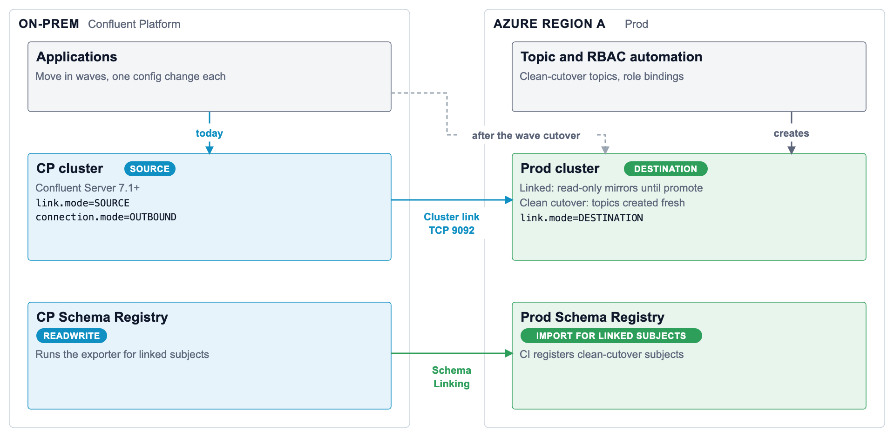
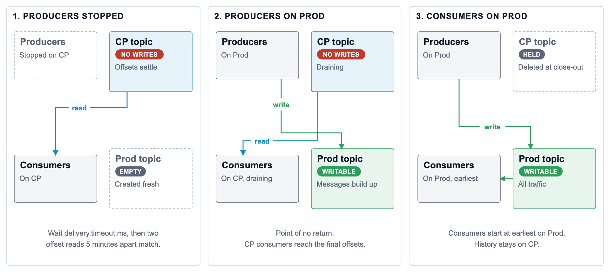
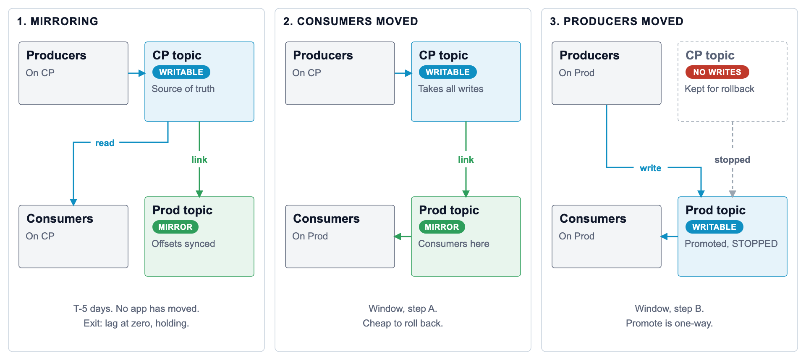

# Confluent Platform to Confluent Cloud migration runbook: clean cutover and Cluster Linking

Sriram Kannan, GoodLabs Studio · Version 0.2 · November 2026 · Draft for review with the platform team · Companions: Link or clean cut decision guide; Confluent Cloud regional DR runbook

## 1. Purpose and summary

Confluent Cloud Prod goes live at the end of November 2026. After that, app teams on the on-prem Confluent Platform (CP) clusters move to Cloud in waves. This runbook is the standard procedure for one wave. It covers both migration paths: clean cutover, which is the default, and Cluster Linking, which we use only where a topic's data or consumer offsets have to carry over.

The choice of path is made per topic group with the decision guide "MRC to Confluent Cloud Active/Active: link or clean cut". This runbook doesn't repeat that reasoning. It takes the decision as an input and describes how each path runs.

Today the Prod cluster is built by hand. An Azure pipeline creates keys and networking, then the cluster is created in the Cloud Console. Topics and RBAC are already automated, and a script reports the role bindings each migrating service account needs. The runbook uses those assets as they are and adds the cutover, Cluster Linking and Schema Linking steps around them.

In short:

- Clean cutover is the default. Producers switch to Prod, CP consumers drain the old topic, then consumers switch. No data, offsets or schema IDs move.
- Cluster Linking is the exception, used only when a topic meets a trigger in the decision guide. There's one source-initiated link per CP cluster, so the data center opens no inbound firewall rule.
- On a linked topic, consumers move first and `mirror promote` runs last. Promote is the only step that can't be undone.
- Schemas follow the path. CI registers them fresh on Prod for clean cutover. Schema Linking carries them with the same IDs for linked topics.
- Identities come from the RBAC migration report on both paths. Every topic is handed to DR on the day it starts taking writes on Prod, using the Confluent Cloud regional DR runbook.

Neither path moves an application by itself. Most of the risk in a wave sits in the minutes after producers stop on CP. Both paths use the same rule there: wait out in-flight writes, and prove the CP topic has stopped moving before the next step.

| Topic | Type | Covered in |
|---|---|---|
| **Starting point and entry criteria** | Prerequisites | Section 2 |
| **Choosing the path, rules and link configuration** | Design | Section 3 |
| **Schema Registry on both paths** | Design | Section 4 |
| **Building a wave** | Planning | Section 5 |
| **Cutover, step by step** | Runbook | Section 6 |
| **What goes wrong and what to do** | Failure modes | Section 7 |
| **Streams apps, connectors and other special cases** | Plan-for items | Section 8 |
| **Open questions and next steps** | Actions | Sections 9 and 10 |

## 2. Starting point and entry criteria

### 2.1 What is in place

| Component | Current state |
|---|---|
| **Prod cluster provisioning** | Manual. Azure pipeline creates keys and networking, then the cluster is created in the Cloud Console. A written build runbook is a go-live requirement. |
| **Topic and RBAC provisioning** | Automated pipeline. Creates the Prod topics for clean cutover. Needs a mirror-aware mode for linked topics (rule 12 in section 3.2). |
| **RBAC migration report** | Script that lists the role bindings each migrating service account needs. It is the input for every wave. |
| **Link or clean cut decision guide** | Sets which topics take the linked path. The result is recorded per topic on the wave sheet. |
| **DR** | Covered by the Confluent Cloud regional DR runbook: a Region B cluster and Schema Registry, a bidirectional Prod to DR link and Schema Linking. This runbook only hands migrated topics over to it. |
| **Source clusters** | On-prem CP. Versions, metadata mode (ZooKeeper or KRaft), listeners and auth vary by cluster and aren't inventoried yet. |

### 2.2 Entry criteria for each CP source cluster

Every CP cluster needs network reachability, private DNS and an inventory before its first wave. The link and Schema Linking rows apply only to a cluster with at least one linked topic. A cluster whose topics all clean-cut doesn't need a cluster link or an exporter.

| Requirement | Applies to | Why it matters |
|---|---|---|
| **CP 7.1.0 or later, Confluent Server brokers, Enterprise license** | Linked | Source-initiated links need all three. Older clusters would need a link that Cloud opens into the data center, which we don't accept. |
| **`confluent.cluster.link.enable=true` on every broker** | Linked | The broker won't run the link without it. If it isn't set, plan a rolling restart of the CP cluster as a separate change. |
| **`password.encoder.secret` set on brokers (ZooKeeper clusters only)** | Linked | It encrypts the Cloud credentials that CP stores in the link. KRaft clusters on CP 8.0 or later don't need it. |
| **Schema Linking enabled on CP Schema Registry** | Linked | The exporter extension isn't on by default. Turning it on is a rolling restart of CP Schema Registry (section 4.2). |
| **Every CP broker reaches every Prod broker on TCP 9092** | Linked | The path is ExpressRoute to Azure Private Link. Firewalls must allow long-lived TCP connections, or the link drops and reconnects. |
| **Every app host reaches Prod over the private network** | Both | After the switch, apps connect to Prod from where they run today. |
| **Private DNS for Prod resolves from the CP brokers and the app hosts** | Both | Clients and the link connect by private hostname, not by IP. |
| **Prod is a Dedicated or privately networked Enterprise cluster in a supported Azure region** | Linked | Basic and Standard clusters can't be link destinations. Azure private networking for Cluster Linking covers a subset of regions, including eastus, eastus2, centralus and westus2. |
| **ExpressRoute headroom** | Both | Linked topics copy their full retained history unless we set a later start point. Clean-cutover topics move their app traffic onto ExpressRoute. |
| **Inventory complete, with a path for every topic** | Both | Topics, consumer groups, producers, connectors, Streams apps and schema subjects, mapped to principals by the RBAC report. |

> **Recommendation for the platform team:** route the CP Schema Registry exporter over the same ExpressRoute and Private Link path as the cluster link, so no schema traffic crosses the internet. To test: from each CP Schema Registry node, call `GET /subjects` on the Prod Schema Registry private endpoint with the exporter's API key. It must return HTTP 200 before the first linked wave.

### 2.3 Workarounds to avoid

- **Linking every topic by default.** Each linked topic adds a mirror, an offset filter, Schema Linking and a promote to the cutover. Use the link only where the decision guide calls for it.
- **Clean-cutting a topic that meets a link trigger.** If the topic is a system of record, or its consumers must resume at exact offsets, a clean cutover loses history or reprocesses data.
- **Starting Prod consumers at latest on a clean cutover.** Producers write to Prod before the consumers start there. A consumer that starts at latest skips those messages.
- **Destination-initiated link from Cloud into the data center.** It needs an inbound firewall rule to every CP broker. Source-initiated links exist to avoid exactly that.
- **ACL sync on the cluster link.** CP principals (`User:CN=...`, LDAP groups) don't exist in Cloud, so synced ACLs would point at nobody. The RBAC report already maps principals to Cloud service accounts.
- **Auto-create mirror topics.** It mirrors topics nobody planned for, internal ones included. Waves only work if we choose exactly what moves and when.
- **Letting apps auto-register schemas on Prod.** CI is the only registrar. On linked subjects, `IMPORT` mode rejects the write anyway, and if it didn't, schema IDs would diverge from CP.
- **Mirror failover for a planned cutover.** Failover stops the mirror at once and can drop the tail. Promote refuses to succeed while the topic is lagging.
- **Moving producers before consumers on a linked topic.** A mirror topic is read-only, so producers can only move after promote. Promoting first would leave CP consumers reading a topic that no longer gets new data.

## 3. Target design

The CP clusters, their clients and their Schema Registry don't change until the cutover window. The topic automation creates clean-cutover topics fresh on Prod. For linked topics we add one cluster link and one schema exporter per CP cluster, both started from the on-prem side, and Prod holds read-only copies until promote. Once a topic takes writes on Prod, the DR runbook takes over.



*Figure 1. Linked path. Every connection starts on-prem and goes out over ExpressRoute to Private Link. Clean-cutover topics skip the link and the exporter.*

### 3.1 Choosing the path

The decision guide sets the triggers. They're restated here so the wave lead can check each topic on the wave sheet. Any one trigger moves a topic to the linked path. If none applies, the topic clean-cuts.

| Trigger | What it looks like |
|---|---|
| **The topic is a system of record** | Long or infinite retention, compacted entity topics, event-sourced stores, or audit history that must exist in Cloud. |
| **The topic is the only copy** | The upstream source can't re-emit: the queue is drained or the database log has aged out. |
| **Consumers must resume at committed offsets** | No gaps and no reprocessing are allowed. |
| **The cutover is phased** | Producers and consumers of the topic run on both clusters for a period. |
| **Rollback to CP must stay possible** | The link keeps both sides in step until validation ends. |
| **No pause is tolerable** | The business can't accept the drain-and-switch gap. |
| **Schema IDs must stay the same** | Consumers read old and new data together. |

The decision guide's rule of thumb holds: if losing or re-reading the data would need a conversation with compliance or an auditor, link it. If the data can be re-derived from a source that is itself authoritative, clean-cut it.

### 3.2 Rules

**Both paths**

1. **Every topic has a recorded path.** The wave sheet names clean cutover or linked for each topic, and the trigger for every linked one.
2. **Identities come from the RBAC migration report.** The report output drives the existing RBAC automation on both Prod and DR. The link's `acl.sync.enable` stays `false`.
3. **When producers stop on CP, their CP write access goes too.** Nothing restarts against CP by accident during or after the window.
4. **After producers stop, wait out in-flight writes before the next step.** Wait at least the producers' `delivery.timeout.ms` (120 seconds by default). Then read the CP topic's log-end offsets twice, 5 minutes apart, and continue only when they match. A producer that was killed rather than closed can still have retries in flight.
5. **CI is the only schema registrar on Prod.** Producers run with `auto.register.schemas=false`. Section 4 covers how each path gets its schemas there.
6. **A topic is handed to DR on the day it starts taking writes on Prod.** Phase 5 runs the DR runbook's add-topic procedure (DR runbook section 6.1). Until it does, the topic has no copy outside Region A.

**Clean cutover**

1. **Prod topics are created fresh by the topic automation.** Name, partition count and configs can be corrected on the way in, including the `<domain>.<entity>.<event>` convention.
2. **Prod consumers start only after CP consumers have drained, with `auto.offset.reset=earliest`.** Draining first keeps per-key order across the switch. Starting at earliest picks up everything producers wrote to Prod while the drain ran.

**Cluster Linking**

1. **One link per CP cluster, source-initiated.** The link has two halves with the same name: the destination half on Prod and the source half on CP. All link behaviour (offset sync, filters, start offset) is set on the Prod half. Name it `<cp-cluster>-to-prod`.
2. **Mirror topics are created per wave, by hand or by pipeline.** `auto.create.mirror.topics.enable=false`. Nothing mirrors until the wave sheet says so.
3. **A mirror topic keeps its source name and partition count.** Neither can change while mirroring. Names that break `<domain>.<entity>.<event>` move as recorded exceptions.
4. **The topic automation never creates a normal topic whose name is linked in an open wave.** If it does, `mirror create` fails because the topic already exists. The pipeline reads the open wave sheets and skips those names.
5. **Consumers move before producers, and promote is the last step in the window.** Consumers can read a mirror topic. Producers can't write to one.
6. **Planned cutovers use `mirror promote`. `mirror failover` is for a CP outage only, and needs incident approval.** Promote checks that the topic isn't lagging before it succeeds. Failover doesn't wait.

### 3.3 Why it works

A clean cutover moves no data, so the only correctness question is ordering. Producers switch first, so every message lands on exactly one cluster. CP consumers finish everything written to CP before Prod consumers start, so no key's events are processed out of order across the switch. The price is that history stays on CP and consumers start on Prod with no committed offsets.

A cluster link replicates byte for byte, so offsets on Prod match offsets on CP. That's what lets the link copy consumer group offsets as they are, and lets a consumer stop on CP and start on Prod at the same position. Schema Linking keeps schema IDs identical, and a serialized message carries only the ID, so mirrored messages deserialize on Prod unchanged. Moving consumers first means the one-way step, promote, happens when producers are already stopped and lag is provably zero.

### 3.4 Link configuration

This applies only to CP clusters with linked topics.

The Prod half is created first. It carries every behaviour setting for the link.

```properties
# cc-link-dst.properties  (Prod half of the link)
# Destination half of a source-initiated link. These two settings go together.
link.mode=DESTINATION
connection.mode=INBOUND
# Waves are explicit: nothing mirrors until we create it.
auto.create.mirror.topics.enable=false
# CP principals don't exist in Cloud. RBAC comes from the migration report.
acl.sync.enable=false
# Copy committed offsets for the groups in open waves only. Edited per wave.
consumer.offset.sync.enable=true
consumer.offset.sync.ms=30000
consumer.offset.group.filters={"groupFilters":[{"name":"payments-ledger-consumer","patternType":"LITERAL","filterType":"INCLUDE"}]}
# Full history by default. Read only when a mirror topic is created.
mirror.start.offset.spec=earliest
```

The CP half holds two sets of credentials: the Prod API key that the link uses to connect out, and the CP identity that the link uses to read locally.

```properties
# cp-link-src.properties  (CP half of the link)
link.mode=SOURCE
connection.mode=OUTBOUND
# Prod cluster, private endpoint. Cloud accepts TLS with SASL/PLAIN (API key).
bootstrap.servers=lkc-prod01.<private-dns-zone>:9092
security.protocol=SASL_SSL
sasl.mechanism=PLAIN
sasl.jaas.config=org.apache.kafka.common.security.plain.PlainLoginModule required username='<link-api-key>' password='<link-api-secret>';
ssl.endpoint.identification.algorithm=https
# How the link reads from CP. Match the CP listener it uses.
local.listener.name=INTERNAL
local.security.protocol=SASL_SSL
local.sasl.mechanism=SCRAM-SHA-512
local.sasl.jaas.config=org.apache.kafka.common.security.scram.ScramLoginModule required username="cp-to-prod-link" password="<from-vault>";
```

```bash
# 1. Prod half first (Confluent CLI, platform team)
confluent kafka link create cp-dc1-to-prod --cluster lkc-prod01 \
  --source-cluster <cp-cluster-id> --config-file cc-link-dst.properties

# 2. CP half (CP admin host, CP platform team)
kafka-cluster-links --bootstrap-server cp-broker-01:9093 \
  --command-config cp-admin.properties --create --link cp-dc1-to-prod \
  --config-file cp-link-src.properties --cluster-id lkc-prod01

# 3. Check from both sides
confluent kafka link describe cp-dc1-to-prod --cluster lkc-prod01
kafka-cluster-links --list --bootstrap-server cp-broker-01:9093 \
  --command-config cp-admin.properties
```

The link's Prod identity is its own service account. It needs only `Cluster: Alter` on Prod. Its API key lives in the vault and rotates on the same 90-day cycle as other keys, which means updating the CP half's `sasl.jaas.config`.

> **Recommendation for the platform team:** where the CP listener the link reads from uses mTLS, set `local.security.protocol=SSL` with the `local.ssl.keystore.*` and `local.ssl.truststore.*` settings in place of the SCRAM lines. Confluent's hybrid tutorial only shows SCRAM. To test: in UAT, create the link against an mTLS listener, mirror one topic, and check that `kafka-cluster-links --list` shows the link healthy and the mirror reaches zero lag.

## 4. Schema Registry

Schemas follow the topic's path. A serialized message carries only its schema ID, so the question for each topic is whether a consumer on Prod will ever read a message written on CP. On a clean cutover it won't. On a linked topic it will.

### 4.1 Clean-cutover topics

Consumers on Prod read only messages written on Prod, so schemas don't need their CP IDs. CI registers each subject on Prod Schema Registry before the window, and Prod assigns new IDs. Nothing is exported, so there is no `IMPORT` mode and no schema close-out step.

1. CI registers at least the latest version of each subject on Prod. If the subject uses a transitive compatibility mode, CI registers the full history, oldest first, so future compatibility checks behave as they did on CP.
2. Set the subject's compatibility mode on Prod to match CP. Where CP has none set, use `BACKWARD`, or `FULL` for contracts shared across teams.
3. Check the subject naming strategy. With `TopicNameStrategy` the subject follows the topic name, so a renamed topic needs its subject registered under the new name.
4. App configs point at the Prod Schema Registry URL with Prod credentials and `auto.register.schemas=false`.

### 4.2 Linked topics: Schema Linking

Mirrored messages keep their CP schema IDs, so those IDs must exist on Prod before a consumer reads a mirror topic. An exporter running inside CP Schema Registry pushes the wave's subjects to Prod Schema Registry over outbound HTTPS and keeps their IDs. The CP registry's own listeners, including mTLS for on-prem clients, don't change.

**Enable the exporter on CP Schema Registry (once per registry)**

```properties
# schema-registry.properties on every CP Schema Registry node.
# Schema Linking isn't on by default. A rolling restart applies these.
resource.extension.class=io.confluent.schema.exporter.SchemaExporterResourceExtension
kafkastore.update.handlers=io.confluent.schema.exporter.storage.SchemaExporterUpdateHandler
# Encrypts the Prod credentials the exporter stores.
password.encoder.secret=<from-vault>
```

If `resource.extension.class` already lists other extensions, such as the RBAC security extension, add the exporter to the list instead of replacing it.

**Create the exporter**

```properties
# prod-sr-exporter.properties  (destination: Prod Schema Registry)
schema.registry.url=https://<prod-sr-private-endpoint>
# API key of a service account scoped to the migrating subjects on Prod.
basic.auth.credentials.source=USER_INFO
basic.auth.user.info=<prod-sr-api-key>:<prod-sr-api-secret>
```

```bash
# Run on a CP Schema Registry host. Subjects for the first linked wave only.
# NONE copies the source default context to Prod's default context as-is.
schema-exporter --create --name cp-dc1-to-prod \
  --subjects payments.transaction.completed-value \
  --context-type NONE \
  --config-file prod-sr-exporter.properties \
  --schema.registry.url https://cp-sr-01:8081
```

**Per wave**

1. Set each of the wave's subjects to `IMPORT` on Prod before the exporter writes to it (`PUT /mode/<subject>`). Every other subject stays `READWRITE`, so greenfield apps can still register on Prod.
2. Add the wave's subjects with `schema-exporter --update --name cp-dc1-to-prod --subjects <list>`. The list replaces the old one, so keep the subjects of any open wave in it.
3. Check that subject, version and schema ID match on CP and Prod.
4. At close-out (section 6.9), remove the subjects from the exporter, set them to `READWRITE` on Prod, and point CI at Prod for them. From then on, CP Schema Registry gets no changes for those subjects.

**Context choice**

The exporter writes into Prod's default context. Broker-side schema ID validation and the Console topic viewer only work with schemas in the default context, and consumers keep a plain registry URL. The risk is an ID clash: an imported CP schema ID that Prod has already given to a greenfield schema.

> **Recommendation for the platform team:** use Prod's default context while only one CP registry exports and its schema IDs can't collide with Prod's. Otherwise use one custom context per source (`--context-type CUSTOM --context-name <cp-cluster>`), and consumers of those topics use the context-qualified registry URL. To test: pull the schema IDs from each CP registry and from Prod (`GET /schemas`) and check that the ranges don't overlap. Repeat before each wave that adds a registry.

### 4.3 Security

- The exporter authenticates to Prod with a service-account API key, stored in the vault and rotated on the 90-day cycle. OAuth through an identity pool is the preferred option once it has been proven in the sandbox.
- An exporter keeps running after its creator's access is revoked. Alert on `POST`, `PUT` and `DELETE` requests to `/exporters` in the CP Schema Registry access logs.

### 4.4 Hand-off to DR

Prod Schema Registry exports to DR Schema Registry as described in the DR runbook (section 4). Clean-cutover subjects reach DR the same way as any subject created on Prod.

> **Recommendation for the platform team:** treat a linked topic as unprotected in DR until its schema close-out in section 6.9, because it isn't yet known whether Prod passes subjects it holds in `IMPORT` mode on to DR (section 9). To test: in UAT, export a subject from a CP registry into a registry held in `IMPORT` mode that itself exports to a third registry, and check whether the subject reaches the third one.

## 5. Building a wave

A wave is a set of topics plus every producer, consumer, connector and schema subject that touches them. We build it from the RBAC migration report, which already maps each principal to the topics it reads and writes. Producers decide the wave: all producers of a topic move together. On a linked topic, promote makes the topic writable for everyone at once. On a clean-cutover topic, the drain can only finish once every CP producer has stopped.

A wave can mix paths. An app that touches both kinds of topic switches once, and section 6.4 gives the order inside the window.

Waves run in this order. The pilot is one low-criticality clean-cutover topic group. Next is the first linked topic, run first as a consumer move only so the link is proven before anything is promoted. Then low-criticality apps that produce and consume, then connectors. Critical apps, exactly-once apps and Kafka Streams apps go last, after earlier waves have produced measured timings.

Each wave has a wave sheet, attached to its change ticket.

| Field | Content |
|---|---|
| **Topics** | Name, path and the trigger for every linked topic, partitions, retention, `cleanup.policy`. Clean cutover: new name and partitions if they change. Linked: mirror start offset and naming exception if any. |
| **Consumer groups** | Group ID, owning app, service account on CP and on Prod. |
| **Producers** | Owning app, service account, `delivery.timeout.ms`, `transactional.id` if set. |
| **Connectors** | Name, type, CP Connect version, target state (repointed or fully managed). |
| **Schema subjects** | Clean cutover: subjects and versions CI registers on Prod. Linked: subjects to add to the exporter and set to `IMPORT`. |
| **People** | App owner per app, wave lead, rollback owner, go/no-go approver. |
| **Window** | Date, start and end time, change ticket number, point-of-no-return time. |

## 6. Cutover

A wave runs in six phases over about two and a half weeks. Only phase 4 changes production traffic, and it runs inside one change window. Each path has a point of no return. On a clean cutover it's the moment producers start writing to Prod. On a linked topic it's promote. Before that point rollback is cheap. After it, we fix forward on Prod, which is why phase 3 makes the go/no-go call explicit.

| Phase | When | Clean cutover | Linked | Rollback |
|---|---|---|---|---|
| **1. Prepare** | T-10 to T-5 days | Topics, schemas and credentials on Prod | Credentials, `IMPORT` mode, exporter subjects | Delete what was created. |
| **2. Mirror and soak** | T-5 to T-1 | Not used | Mirror topics, offset sync, lag to zero | Delete the mirror topics. |
| **3. Go/no-go** | T-1 | Yes | Yes | Move the wave. |
| **4. Window** | Window | Producers switch, CP consumers drain, consumers switch | Consumers move, then producers move and promote | Cheap before the point of no return. Fix forward after it. |
| **5. Hand off to DR** | Window end to T+1 | DR runbook 6.1 | DR runbook 6.1 | Not needed. |
| **6. Hypercare and close-out** | T+1 to T+14 | Hold CP topics, then delete | Schema close-out, hold CP topics, delete link last | Hold CP topics until close-out. |

### 6.1 Phase 1: prepare (T-10 to T-5)

1. Platform team runs the RBAC migration report for every principal on the wave sheet and reviews the output with the app owners.
2. The RBAC automation creates the service accounts, role bindings and API keys (or identity pool mappings) on Prod and on DR. Keys go into the vault.
3. Clean cutover: the topic automation creates the Prod topics, with the corrected name and partition count where agreed, and CI registers their schemas on Prod (section 4.1).
4. Linked: the pipeline creates no topics with these names. Platform team sets the subjects to `IMPORT`, adds them to the exporter and checks parity (section 4.2). It also reviews the source topic configs, because they carry over from CP and can't change while mirroring.
5. App teams prepare the Cloud config as a deployable change: Prod bootstrap, API key or OAuth settings, Schema Registry URL and credentials, and `auto.register.schemas=false`. Consumers of clean-cutover topics also set `auto.offset.reset=earliest`. They don't deploy it yet.
6. Wave lead raises the change ticket with the wave sheet attached.

Done when every principal in the wave can authenticate to Prod and DR and list the topics it is allowed to see.

### 6.2 Phase 2: mirror and soak (T-5 to T-1, linked topics only)

1. If any topic needs a later start point, set `mirror.start.offset.spec` on the link first. The setting only applies to mirror topics created after the change.
2. Create each mirror topic: `confluent kafka mirror create payments.transaction.completed --link cp-dc1-to-prod --cluster lkc-prod01`.
3. Add the wave's consumer groups to `consumer.offset.group.filters` with `confluent kafka link configuration update cp-dc1-to-prod --config new-filters.properties --cluster lkc-prod01`. The value replaces the whole filter, so keep the groups of any other open wave in it.
4. Watch mirror lag (`confluent kafka mirror describe`, Metrics API) and ExpressRoute utilisation until the first copy finishes.
5. Check each topic: the mirror is `ACTIVE`, lag is zero on every partition, and a sample consumed on Prod deserializes with the app's schema.

Done when every mirror topic has held zero lag for 24 hours and every group in the filter has committed offsets on Prod.

### 6.3 Phase 3: go/no-go (T-1)

The wave lead runs this check with the approver. Any failed row moves the wave.

| Check | Pass condition |
|---|---|
| **Prod topics (clean cutover)** | Exist with the agreed name, partitions and configs, and are empty. |
| **Mirror lag (linked)** | Zero on every partition for 24 hours. |
| **Consumer offsets (linked)** | Every group on the wave sheet has offsets on Prod within one sync interval of CP. |
| **Schemas** | Clean cutover: registered on Prod at the expected versions. Linked: subject, version and ID parity. |
| **Credentials** | Every app's Prod and DR credentials tested from the app's own network. |
| **App changes** | Cloud config changes approved and ready to deploy. |
| **DR** | The DR runbook's steady-state checks pass (DR runbook section 6.2) and DR credentials exist for the wave. |
| **Monitoring** | Dashboards and alerts on Prod include the wave's topics and groups. |
| **People** | App owners, CP platform team and rollback owner confirmed for the window. |
| **Point of no return** | Approver signs off the time after which producers may start on Prod (clean cutover) and promote may run (linked). |

### 6.4 Phase 4: window order

Producers stop on CP once, for every topic in the wave. The order below keeps that true when a wave mixes paths. A wave with only one path skips the steps that don't apply.

1. Linked step A: move the consumers of linked topics (section 6.6).
2. Stop every producer in the wave on CP, remove their CP write access, and wait out in-flight writes (rule 4 in section 3.2).
3. Linked step B: promote the linked topics and wait for `STOPPED` (section 6.7).
4. Start every producer in the wave on Prod.
5. Clean cutover: drain CP consumers, then start them on Prod (section 6.5).

### 6.5 Phase 4, clean cutover



*Figure 2. Clean cutover, one topic: producers stop on CP and the buffer runs, then producers write to Prod while CP consumers drain, then consumers start on Prod at earliest.*

Repeat for each clean-cutover topic group. Steps 1 and 2 are shared with linked topics when the wave is mixed.

1. Stop every producer of the topic on CP. The CP platform team removes their write role bindings or ACLs on CP.
2. Wait out in-flight writes: at least the producers' `delivery.timeout.ms`, then two reads of the CP topic's log-end offsets, 5 minutes apart, that match. Record the final offsets on the wave sheet.
3. Deploy the Cloud config and start the producers on Prod. Messages now build up on the Prod topic. This is the point of no return for the topic.
4. Let the CP consumers drain. A group is done when its committed offsets on CP equal the final offsets from step 2 (`kafka-consumer-groups --describe --group <group>` against CP).
5. Stop the CP consumers.
6. Deploy the Cloud config and start the consumers on Prod. They have no committed offsets there, so they start at earliest, which is the first message producers wrote to Prod.
7. App owners confirm end to end: produce and consume rates are normal, lag is falling, there are no auth or schema errors, and the business check passes.

Done when producers and consumers have run on Prod for 30 minutes with no errors.

**Rollback**

Before step 3, restart the producers on CP and restore their write access. Nothing has been written to Prod, so nothing is lost. After step 3, new records exist only on Prod, so we fix forward. A consumer problem after step 6 loses no data: the Prod topic holds everything written since step 3, and the consumer resumes from its last commit, or from earliest, once it's fixed. Prod retention must cover that time.

### 6.6 Phase 4, linked step A: move consumers



*Figure 3. Linked path, one topic: mirrored first, then consumers move while CP still takes writes, then producers move and the topic is promoted.*

Repeat for each consumer group of a linked topic.

1. Stop every instance of the consumer on CP. Confirm the group has no members: `kafka-consumer-groups --describe --group payments-ledger-consumer` against CP.
2. Wait for at least two offset sync intervals (60 seconds at the default 30 seconds). Confirm the group's committed offsets on Prod match CP.
3. Remove the group from `consumer.offset.group.filters`, so the link can't overwrite offsets that the consumer now commits on Prod. This also stops promote from hanging in `PENDING_MIRROR` later.
4. Check that the mirror topic has caught up past the group's offsets: consumer lag on Prod must be greater than mirror lag. If the consumer starts ahead of the mirror, it resets to the end of the topic and reads some messages twice.
5. Deploy the Cloud config and start the consumer on Prod. It reads the mirror topic from the synced offsets.
6. App owner confirms the group is stable, lag is falling, there are no deserialization errors, and the business check passes.

Done when every consumer of the wave's linked topics has run on Prod for 30 minutes with lag at its normal level and no errors.

> **Recommendation for app teams:** make every consumer of a linked topic idempotent before its wave, because both rollback here and a restart after promote can process some messages twice. To test: in UAT, stop the consumer on Prod mid-stream, restart it on CP from its last CP offset, and check the business output has no duplicate effects.

**Rollback**

Stop the consumer on Prod and start it again on CP. It resumes from its last CP offset, so messages processed on Prod since the move are processed again. Consumers must be idempotent for this to be safe. No data is lost. Put the group back in the offset filter if the wave is rescheduled.

### 6.7 Phase 4, linked step B: move producers and promote

1. Stop every producer of the linked topic on CP. The CP platform team removes their write role bindings or ACLs on CP.
2. Wait out in-flight writes: at least the producers' `delivery.timeout.ms`, then two reads of the CP topic's log-end offsets, 5 minutes apart, that match. Then confirm mirror lag is zero.
3. Promote: `confluent kafka mirror promote payments.transaction.completed --link cp-dc1-to-prod --cluster lkc-prod01`. Promote fails if the topic is still lagging. After it runs, mirroring and offset sync stop for good.
4. Run `confluent kafka mirror describe` until every topic shows `STOPPED`. Don't start producers while a topic is `PENDING_STOPPED`: writes can fail and reads can duplicate.
5. Deploy the Cloud config and start producers on Prod.
6. App owners confirm end to end: produce rate is back to normal, consumers on Prod receive new messages, and there are no auth or schema errors.

Done when producers and consumers have both run on Prod for 30 minutes with no errors.

**Rollback**

After promote the Prod topic is independent, and records written to it exist only on Prod. The default is to fix forward on Prod: credentials, schemas and config are the usual causes, and all of them can be fixed without moving data. Going back to CP is the reverse migration from Confluent's migration guide. Stop clients on Prod and delete the original topics on CP. Create a Prod to CP link that CP initiates, and mirror the topics back with consumer offset sync. Then promote on CP and repoint apps. It takes hours, not minutes. It is rehearsed in UAT before the first wave that promotes, and it isn't improvised in the window.

### 6.8 Phase 5: hand off to DR (window end to T+1)

1. Run the DR runbook's add-topic procedure (DR runbook section 6.1) for every topic that started taking writes on Prod, promoted and clean-cutover alike.
2. Confirm alerts on the wave's topics fire to the on-call rota (test one).

Done when every DR mirror for the wave shows zero lag and the wave's schemas exist on DR Schema Registry with the same IDs as Prod.

### 6.9 Phase 6: hypercare and close-out (T+1 to T+14)

- App owners and the wave lead check health daily for five business days.
- Linked schema close-out: remove the wave's subjects from the CP exporter, set them to `READWRITE` on Prod, and point CI schema registration for them at Prod.
- After the agreed hold period, the CP platform team deletes the wave's CP topics and removes the CP role bindings, ACLs and credentials for its apps. For clean-cutover topics, the hold ends only after the app owner confirms from the business side that nothing was missed across the switch.
- The cluster link is deleted only when no wave on that CP cluster has an open linked topic, and only after every mirror topic on it shows `STOPPED`. Deleting a link while a topic is `PENDING_STOPPED` can leave that topic unrecoverable.

Done when the wave sheet is closed and the change ticket records actual timings for each phase.

## 7. Failure modes

### 7.1 CP log-end offsets keep moving after producers stop

A producer that isn't on the wave sheet is still writing. Don't take the next step: on a clean cutover its messages would land after the drain, and on a linked topic promote would leave them behind. Find the principal from the CP broker request metrics or audit logs, add it to the wave or remove its write access, and repeat the two offset reads.

### 7.2 CP consumers won't drain (clean cutover)

Producers are already on Prod, so writes continue and only consumer latency grows. The usual cause is a slow consumer or a message it can't process. Fix the consumer on CP. Don't start Prod consumers early: they would process new events before the old ones for the same key. If the business accepts out-of-order processing for this topic, the approver can let Prod consumers start in parallel, and the wave sheet records that.

### 7.3 Mirror lag won't reach zero during the soak

The cause is usually ExpressRoute bandwidth, CP broker load, or a single large partition. Don't open the window. Check link metrics and CP broker request queues, spread the first copy of large topics over several days, or recreate the mirror with a later `mirror.start.offset.spec` if the app doesn't need full history.

### 7.4 The link drops between linked step A and step B

Consumers on Prod stop seeing new data while producers still write to CP. Data isn't lost, it waits on CP.

**During the outage**

1. Wave lead declares a hold and the CP platform team checks the link from the CP side (`kafka-cluster-links --list` shows whether the remote cluster is reachable).
2. If the link isn't back within 15 minutes, roll consumers back to CP (section 6.6 rollback).
3. Don't promote. Promote can't complete while the link is down.

### 7.5 Promote fails or hangs

Producers are already stopped, so the outage clock is running. Promote fails if it can't confirm the topic has caught up, which usually means the link is down. A promote stuck in `PENDING_MIRROR` means a group that is already active on Prod is still in the offset filter: remove it and retry. Otherwise restore the link and retry. If that can't happen inside the window, restart producers on CP, roll consumers back, and close the window. `mirror failover` is used here only if CP itself is lost, with incident approval and acceptance that the records in the lag window are gone.

### 7.6 Producers can't write on Prod

On a linked topic, first check the topic is `STOPPED`, not `PENDING_STOPPED`. Otherwise it is a credentials, role binding or schema problem. Fix it on Prod. Restoring CP write access is a last resort, because anything already written to Prod has to be reconciled by the app team.

### 7.7 Consumers on Prod hit deserialization errors

On a clean cutover, a schema CI should have registered is missing on Prod: register it and the consumer recovers on retry. On a linked topic, a schema ID is missing on Prod. Check the exporter status on CP Schema Registry and confirm the subject is in its list. Restart the exporter if it's paused. Consumers resume once the ID exists, because they retry the lookup.

### 7.8 CP cluster outage while a wave is open

Linked topics not yet promoted only exist in full on CP. With incident approval, `mirror failover` makes them writable on Prod with whatever was copied, and records in the lag window are lost. Clean-cutover topics whose producers haven't switched simply move early, with the undrained CP messages left behind until CP is back. Both are decisions for the incident lead, not part of the standard wave.

> **Recommendation for the platform team:** rehearse the window in UAT before wave 1 and size each window from what you measure. To test: time a clean-cutover drain on the largest topic in wave 1 and promote on the largest linked topic, remove a group from the offset filter mid-window and check its Prod offsets hold, and run the reverse-mirror rollback in section 6.7 end to end.

> **Recommendation for app teams:** owners of Kafka Streams apps run a full cutover rehearsal in UAT before their wave. To test: move the app with its input and changelog topics, and check that state restores on Prod without a rebuild and the output matches CP for the same input.

## 8. Points to plan for

| Topic | Detail |
|---|---|
| **Kafka Streams apps** | Usually linked. They move as one unit with their input topics. Mirror the internal changelog topics too, so state restores on Prod instead of rebuilding from scratch. Each app gets a UAT rehearsal first. |
| **Transactional producers** | Transaction state doesn't move. Open transactions on CP must commit or abort before the offset check in rule 4 passes. Producers start fresh on Prod with the same `transactional.id`. |
| **Sink connectors** | Linked topic: the managed connector resumes from carried offsets. Clean cutover: pick a replay point on Prod and make the target tolerate duplicates. |
| **Source connectors** | They write, so they start on Prod only after promote (linked) or with the other producers (clean cutover). Carry the external position over with the offsets API, which needs CP 7.6 or later on the Connect cluster. S3, Azure Blob and GCS sources can't be created with carried-over offsets, and custom connectors don't support offset management. |
| **ksqlDB** | Out of scope for this runbook. ksqlDB apps are rewritten as Flink SQL and planned separately. |
| **Client auth** | Kerberos and LDAP don't exist on Cloud. Apps move to API keys or OAuth through the identity provider as part of the Cloud config change. |
| **Prod retention** | Clean-cutover topics must retain long enough to cover a consumer outage after producers switch. |
| **Prod capacity** | Each wave adds ingress, partitions and connections to Prod and DR. Check against cluster limits during phase 1. |
| **Change freeze** | Confirm December freeze dates before scheduling the pilot wave. |

## 9. Open questions

| Question | Owner | Why it matters |
|---|---|---|
| **Which topics meet a link trigger?** | App owners, compliance | Sets which topics, CP clusters and registries need a link and an exporter. |
| **Version, metadata mode, listeners and auth of each CP cluster with linked topics** | CP platform team | Below 7.1 means an upgrade first. Below 7.6 on Connect blocks offset carry-over. |
| **Is `confluent.cluster.link.enable` already set on those CP brokers?** | CP platform team | If not, each such cluster needs a rolling restart before its first linked wave. |
| **Can the CP Schema Registry exporter reach Prod Schema Registry privately?** | Network team, Confluent | Schema Linking is part of every linked wave. |
| **Schema ID ranges in use on each CP registry and on Prod** | Platform team | Decides between the default context and one context per source. |
| **Can Prod Schema Registry export subjects it holds in `IMPORT` mode on to DR?** | Confluent | Decides how linked schemas reach DR before close-out. |
| **ExpressRoute headroom for first copies and moved app traffic** | Network team | Sets how many topics a wave can move at once. |
| **Hold period for CP topics after the switch** | Risk, app owners | Sets when CP capacity is freed. |

## 10. Next steps

1. App owners and compliance classify every topic against the triggers in section 3.1, and the result goes on the wave sheets.
2. CP platform team checks every CP cluster against section 2.2, including the link and Schema Linking rows for clusters with linked topics.
3. Network team confirms private reachability and DNS from the CP brokers and app hosts to Prod, and ExpressRoute headroom.
4. Platform team adds the mirror-aware mode to the topic automation, sets up CI schema registration on Prod, and feeds the RBAC report output into the wave sheet.
5. GoodLabs runs both paths end to end in UAT: one clean-cutover topic group and one linked topic, including a step A rollback and a promote, and updates this runbook with measured timings.
6. App owners nominate the pilot topic group.
